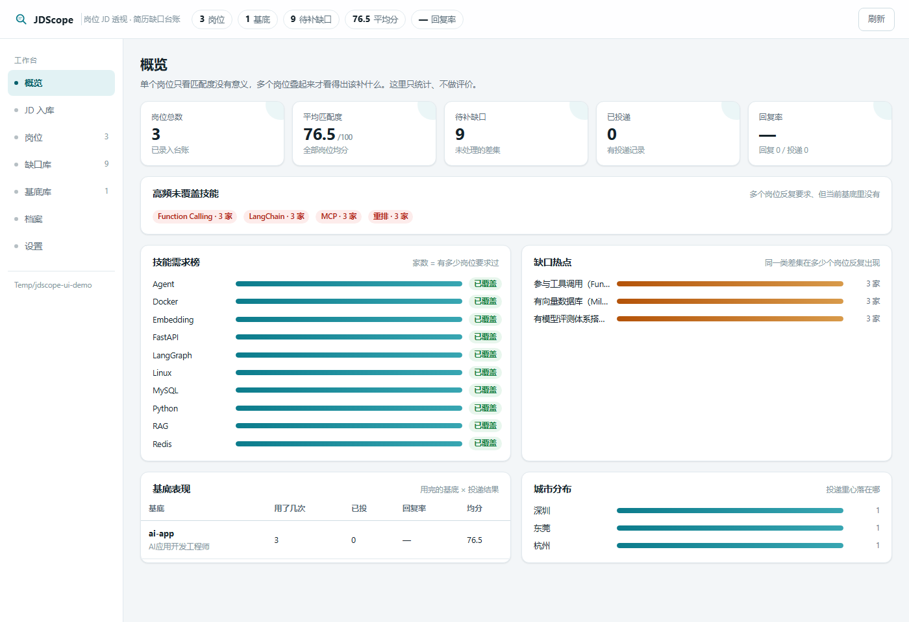
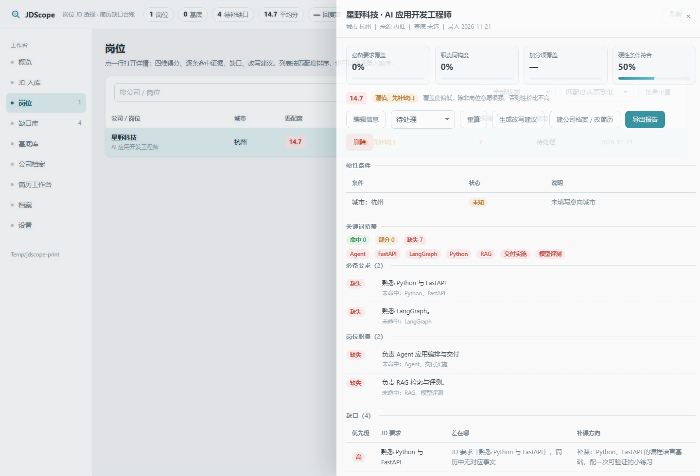
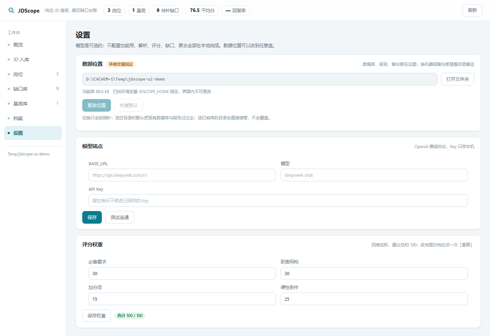
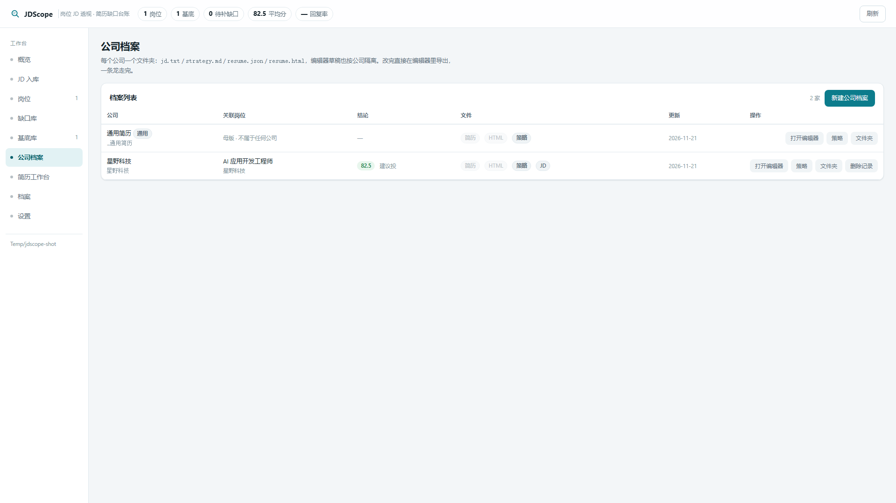
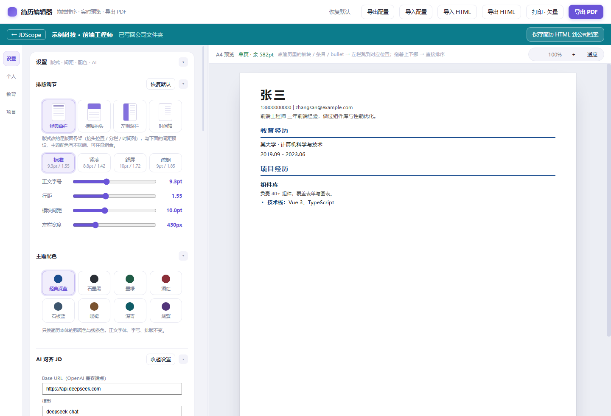

# JDScope

**把岗位 JD 变成可决策的结构化数据，并沉淀成一份跨岗位的缺口台账。**

本地单机、零云端、零账号。**[下载 JDScope.exe](https://github.com/Q1anyii/jd-scope/releases/latest/download/JDScope.exe)**，双击就能用。

---

## 它是什么，不是什么

求职时真正费时的不是「改简历」，而是这三件事：

1. 这条 JD 我到底该不该投
2. 该改哪几行、改到什么程度不算编造
3. 投了二十家之后，我反复被卡在什么地方

现成工具基本只解决第 1 步的前半截（给个漂亮的模板、润色措辞），或者只解决「投出去了没」。
JDScope 只做中间这一层：**决策层**。

- **不重复造简历编辑器**：内嵌作者既有的单文件编辑器（`app/web/editor/`，见「内嵌编辑器」一节），JDScope 只负责决策与串联。
- **不做自动投递与爬虫**：那是投递工具的事，且平台风控风险高。
- **不做「一键生成简历」**：本工具的红线是「只改表达、不动事实」，一键生成必然越界。

## 界面

概览（跨岗位聚合）：



岗位详情（四维得分、逐条命中证据、缺口、改写建议）：



设置（数据位置可改到任意盘）：



公司档案（每家公司一个文件夹，简历 / 策略 / JD 放一起）：



内嵌的简历编辑器（打开即载入该公司档案，改完一键写回）：



## 核心能力

| 能力 | 说明 |
|---|---|
| JD 结构化 | 按「职责 / 要求 / 加分」三段切分，抽学历、专业、年龄、年限、英语、城市与需求条目；学历/专业/年龄这类资格行单独归入硬条件，不再当作技术能力条目拉低覆盖 |
| 基底选型 | 按「术语命中数 → 覆盖面 → 意向同名」自动挑母版，并给出命中证据，不是黑盒结论 |
| 四维评分 | 必备要求覆盖 / 职责同构度 / 加分项覆盖 / 硬性条件，加权得 0–100 分，每分可回溯到条目 |
| 缺口差集 | 只记「JD 明确要求但简历未覆盖」的差集，标高/中/低优先级，附补课方向 |
| 跨岗位聚合 | 技能需求榜（要求家数 vs 我的覆盖）、缺口热点、基底表现、城市分布 |
| 交付物 | 一键生成 Markdown 报告：结论 / 四维 / 选型理由 / 关键词覆盖 / 缺口 / 改动摘要 / 面试提示 |
| 可选模型 | OpenAI 兼容端点（默认 DeepSeek），用于改写建议与面试应答口径；不配置也能用 |
| 提示词可改 | 设置页「模型端点」下新增两个可滚动页签：「JD 分析提示词」控制 JD 的 AI 解析，「简历改写提示词」控制岗位详情的生成改写建议；留空或填入默认原文即回到内置默认，必须保留 JSON 输出协议 |
| AI 只出候选 | JD 入库的 AI 解析、改写建议、面试口径都先把条目摆出来，**勾选/点「采用」才入库**；没勾的不参与打分，也不改台账 |
| 岗位信息可改 | 详情抽屉里点「编辑信息」可改公司名、岗位名、城市、来源与链接，保存后列表与详情同步刷新；空公司名 / 空岗位名会被拒绝 |
| 一条龙 | 岗位详情 →「建公司档案 / 改简历」→ 内嵌编辑器（自动带上 JD、策略与基底）→ 导出 HTML / PDF 回公司文件夹 |
| 简历工作台 | 侧栏常驻入口，直接打开 `resumes/_通用简历/` 的母版；不属于任何公司，随时改、随时导出，也是各公司定制版的起点 |
| 公司档案 | 每家公司一个文件夹：成品简历用 `姓名-岗位名-简历.html / .pdf`，`jd / report / strategy` 用 `公司-岗位名-` 前缀，`resume.json` 是编辑器草稿；同名自动加序号，删除记录不删文件 |
| 筛选与跳转 | 岗位支持录入日期区间、状态、关键词与排序；公司档案支持更新日期区间、类型（通用/定制）、结论、关键词与排序，点关联岗位直接打开对应岗位详情 |
| 数据位置可选 | 设置页可把数据库与报告改到任意盘；空目录自动迁移，已有库目录直接接管，不覆盖 |

## 快速开始

### 下载即用（推荐）

1. 打开 [Releases](https://github.com/Q1anyii/jd-scope/releases/latest)，或直接 **[下载 JDScope.exe](https://github.com/Q1anyii/jd-scope/releases/latest/download/JDScope.exe)**
2. 双击 `JDScope.exe`（Windows 10/11，首次启动约 3–5 秒，无命令行窗口）；未签名版本可能被 SmartScreen 提示，点「更多信息 → 仍要运行」
3. 若想放到桌面：右键 exe 发送到桌面快捷方式，或从源码运行 `build\create_shortcut.ps1`

### 用源码运行

```powershell
python run.py            # 打开桌面窗口
python run.py --serve-only --port 8765   # 只起服务，便于调试
```

依赖（运行只需 Python 3.10+，标准库足够；桌面窗口需要 pywebview）：

```powershell
pip install -r requirements.txt
```

## 首次使用七步

1. **档案**：填学历、专业、年龄、年限、意向城市、证书 —— 只用于硬性条件判定，存在本机
2. **基底库**：导入 1–3 份通用简历（HTML 或 TXT），登记代号与求职意向；登记后可在列表里点「编辑」改元信息或正文，正文改动会自动重算关键词
3. **JD 入库**：粘一段 JD，点「解析预览」确认抽取结果；想更细就点「AI 补解析」逐条勾选，再「保存并分析」
4. **看详情**：四维得分、逐条命中证据、缺口清单、缺口补课方向
5. **建公司档案**：详情里点「建公司档案 / 改简历」，自动生成 `公司-岗位-strategy.md` 与 `公司-岗位-jd.txt`，并打开编辑器
6. **改完导出**：编辑器里点「保存简历 HTML 到公司档案」，写回 `姓名-岗位名-简历.html`
7. **导报告**：把「下一投要改哪三行」落成一份 Markdown

没想清楚先试？「JD 入库」页有「填入示例 JD」，`samples\` 下也有一份合成简历可用。

## 数据放在哪

默认 `%LOCALAPPDATA%\JDScope\`：

```
location.json  位置指针（只在自定义或改回默认时出现）
jdscope.db     SQLite（岗位、需求条目、缺口、基底、公司档案、设置）
reports\       导出的 Markdown 报告
resumes\       公司档案，一家一个文件夹（成品简历 / 策略 / JD / 报告）；_通用简历 为母版
backups\       预留
```

三种改法，优先级从高到低：

1. **设置页可视化切换**（推荐）：选一个空目录 → 自动迁移数据库、报告与备份；选已有数据库的目录 → 直接接管，不覆盖、会先提示冲突。
2. 环境变量 `JDSCOPE_HOME`：整目录隔离，设置页会标记为「环境变量指定」并锁定切换。
3. 手动编辑 `location.json` 的 `data_home` 字段（路径须为绝对路径）。

设计上把「指针」和「数据」分开：`location.json` 永远待在配置根，所以不会出现「指针存在被指针指向的目录里」这种死循环。
切换不会重启进程，下一次请求自然连到新库。备份直接复制数据目录即可。
本项目仓库内不含任何个人数据、不含任何绝对路径。

## 内嵌编辑器

侧栏「简历工作台」是通用简历（母版）的常驻入口，对应 `resumes/_通用简历/`；它不属于任何岗位，随时可改、可导出，也是各公司定制版的起点。

`app/web/editor/index.html` 是简历编辑器原文件（作者自建的单文件版，HTML/CSS/JS 全内联，无外部依赖）的副本，随仓库分发。JDScope 只加了一层很薄的桥接，不改它的编辑与排版逻辑：

| 时机 | 行为 |
|---|---|
| 打开 `?company=<id>` | `STORE_KEY` 加上 `:company-<id>` 命名空间，多家公司的 localStorage 草稿互不覆盖 |
| 进入页面 | 拉 `/api/companies/<id>/resume` 的 `resume.json`；没有就拉建档时留下的 `base.html`，用编辑器自带的 `parseResumeHtml()` 还原成可编辑结构，然后删掉 `base.html` |
| 编辑 | 复用编辑器原有的 `save()`（400ms 防抖），额外 900ms 防抖把状态 POST 回公司文件夹；**API Key 不落盘，也不下发到页面** |
| AI 对齐 JD | 嵌入模式走同源代理 `POST /api/editor/chat`，服务端直接用「设置」里的 Base URL / 模型 / Key；编辑器不再单独填 Key，公司 `公司-岗位-jd.txt` 自动灌进「目标 JD」。编辑器自己的 System Prompt 仍在编辑器内修改，设置页的两个提示词不覆盖它 |
| 导出 | 顶栏「保存简历 HTML 到公司档案」把 `exportHtmlSource()` 的成品写成 `姓名-岗位名-简历.html`；成功的提示条右侧带「打开文件夹」，一键跳到公司档案目录 |
| 导出 PDF | 右上「导出 PDF」先弹 A4 预览，红色虚线标出分页位置，确认后按 A4 分页生成约 240dpi 文件；不再依赖系统打印窗口。从公司档案进入时，PDF 同时归档为 `姓名-岗位名-简历.pdf`，目录里已有同名文件则跳过、不覆盖 |
| 导出 HTML | 独立使用时下载一份干净 HTML；嵌入公司档案时这个按钮隐藏，统一用公司条的「保存简历 HTML 到公司档案」，避免两个入口抢同一件事 |
| 返回 | 顶栏左侧「← JDScope」回岗位台账 |

事实源是 `resume.json`（可继续编辑），`姓名-岗位名-简历.html` 是投递用快照。这样同一份内容既能反复改，也能直接拿去投。
通用简历和公司档案用的是同一套桥接：`/editor/?company=<id>` 里的 id 对母版同样成立（母版就是一条 `kind=general` 的档案），所以母版也自动获得回写与导出能力。
原编辑器更新时，把它重新复制成 `app/web/editor/index.html`，再按 `STORE_KEY`、`save()`、启动序列、顶栏、AI 代理五处重新打补丁即可。

## 评分口径

```
总分 = (must*30 + duty*30 + nice*15 + constraint*25) / 权重和
```

- 每条需求：命中 = 100%、仅同领域 = 50%、未命中 = 0；没有可对照技术术语的条目（如「有责任心」）不计覆盖率、不生成补课缺口
- 硬性条件：满足 1.0 / 部分 0.55 / 未知 0.5 / 不满足 0
- 只要有一条硬性条件判为「不满足」，直接判「不建议投」——不做加权掩盖

阈值可在「设置」里改权重；改完对岗位点一次「重算」。

## 构建

```powershell
powershell -ExecutionPolicy Bypass -File build\build_exe.ps1
```

产物：`dist\JDScope.exe`（单文件、windowed、自带图标），构建脚本最后会刷新桌面快捷方式。
图标：`assets\icon-src.png` 为源图，`tools\png_to_ico.py` 负责裁边、圆角外透明、按尺寸简化（16px 去掉镜片内细线）并写出 7 层 ICO；没有源图时回退到 `tools\make_icon.py`（纯标准库绘制）。
启动顺序：WebView2 原生窗口 → Edge/Chrome `--app` 窗口 → 默认浏览器。端口被占用会自动退回临时端口，不会静默失败。

## 自动发布

推送 `v*` tag 后，GitHub Actions 会自动完成打包并创建**草稿 Release**：

```powershell
git tag v0.3.6
git push origin v0.3.6
```

流水线会先校验 tag 与 `app/config.py` 的 `APP_VERSION` 一致，然后在 `windows-latest` 上执行 `build\build_exe.ps1 -SkipShortcut`，上传 `dist\JDScope.exe`，并用 `--generate-notes` 从提交历史生成摘要草稿。你只需要打开 Releases，改一下摘要，确认发布。

## 代码签名

签名不是“写一段代码让 Windows 信任”，而是用受信任的代码签名证书给 exe 做 Authenticode 签名。

- 不签名：SmartScreen 会提示「Windows 已保护你的电脑」。
- 自签名证书：对公开用户与不签名基本一样，仍会提示未知发布者，只适合内部测试。
- OV / EV 证书、Azure Artifact Signing：会显示已验证的发布者，但**首次下载仍可能提示**，需要同一发布者持续签名来积累声誉；EV 已不再直接绕过 SmartScreen。
- 签名能改善“未知发布者”的信任问题，但不是杀毒白名单，不能保证不被误报。

如果要启用签名，在仓库 Secrets 中配置：

- `WINDOWS_CERT_PFX_BASE64`：`.pfx` 文件的 Base64
- `WINDOWS_CERT_PFX_PASSWORD`：`.pfx` 密码

工作流会自动调用 `signtool` 签名并验证；未配置时构建保持未签名，不会伪造证书。证书需要自行向 CA 申请（Azure Artifact Signing 目前对个人开发者仅开放美国/加拿大，组织开放美国/加拿大/欧盟/英国），中国大陆个人开发者通常需要走 OV 证书渠道；具体以 CA 和微软的资格审核为准。

参考：[SmartScreen reputation](https://learn.microsoft.com/en-us/windows/apps/package-and-deploy/smartscreen-reputation)、[Code signing options](https://learn.microsoft.com/en-us/windows/apps/package-and-deploy/code-signing-options)。

## 测试

```powershell
python -m unittest discover -s tests -v
```

覆盖词表最长匹配、JD 三段切分、硬性条件判定、基底选型、聚合统计、报告结构、数据目录切换（迁移 / 接管 / 冲突拒绝 / 环境变量锁定 / 指针损坏回退）、公司档案（建档 / 同名加序号 / 简历回写 / 导出 HTML / PDF 归档且不覆盖 / 旧文件名迁移 / 删除留档 / 通用母版）、基底编辑、AI 候选合并与重算保留、岗位元信息编辑、设置页提示词保存与模型调用注入、嵌入编辑器模型代理与 JD 回灌、v1 → v4 迁移，以及 HTTP 接口链路。共 73 个用例。

## 目录

```
app/
  config.py      路径与常量（配置根、数据目录指针、权重、阈值）
  location.py    数据目录切换：校验、迁移、接管、原子落指针
  lexicon.py     通用技术词表与检索归一
  jdparse.py     JD 结构化抽取
  analyze.py     基底选型 + 四维评分 + 缺口差集
  companies.py   公司档案：按公司建文件夹、写简历 / 策略 / JD / 报告
  aggregate.py   跨岗位聚合
  reportmd.py    交付物 Markdown
  llm.py         可选的 OpenAI 兼容客户端（严格 JSON）
  api.py         纯标准库 HTTP 接口
  main.py        桌面入口（WebView2 / --app / 浏览器三级回退，含选目录桥）
  web/
    index.html   壳
    css/app.css  单文件设计系统
    js/          Vue 3 页面组件（store + 8 个页面）
    vendor/      Vue 3.5.13 全局构建（MIT，随仓库分发，不依赖 Node）
    editor/      内嵌简历编辑器（单文件，含公司档案桥接）
tools/
  make_icon.py       纯标准库绘制多尺寸 ico（无源图时的回退）
  png_to_ico.py      源图转 ico：裁边、圆角外透明、小尺寸简化
build/
  build_exe.ps1      PyInstaller 打包
  create_shortcut.ps1 桌面快捷方式（图标取自 exe）
samples/             合成样例数据（非真实个人信息）
tests/               单元测试
```

前端用 Vue 3 的全局构建（`vue.global.prod.js`，运行时编译模板），**没有 Node、没有构建步**：
页面上就是 7 个可读的 `.js` 文件，改完刷新即可生效，打包时 `--add-data app\web` 原样带走。

## 已知限制

- 只支持中文 JD 的常见三段式结构；结构极不规范的 JD 会退化成「整段按必备要求处理」
- 词表是通用技术栈，冷门技术不会自动识别，可在 `app/lexicon.py` 里追加
- 硬性条件判定学历、专业、年龄、年限、英语、城市六项，不做薪资与行业判断；年龄只按 JD 明写的上限做提示，不直接判「不满足」
- AI 解析依赖模型端点；没配 Key 时按钮会直接提示，规则解析照常可用
- 内嵌编辑器是 vendored 副本（约 148KB），原编辑器更新需要手工同步一次
- 公司档案的「简历事实源」是编辑器 JSON；HTML 基底首次导入依赖编辑器自带的解析器，结构差异过大的旧 HTML 可能只认出部分模块

## 许可

MIT。词表与规则为本项目原创；不分发任何第三方投递脚本。内嵌的简历编辑器是作者的另一个自建工具（`resume-editor`，单文件、无第三方依赖），随本项目一同分发，其编辑与排版逻辑不属于本项目的评分/决策代码。
